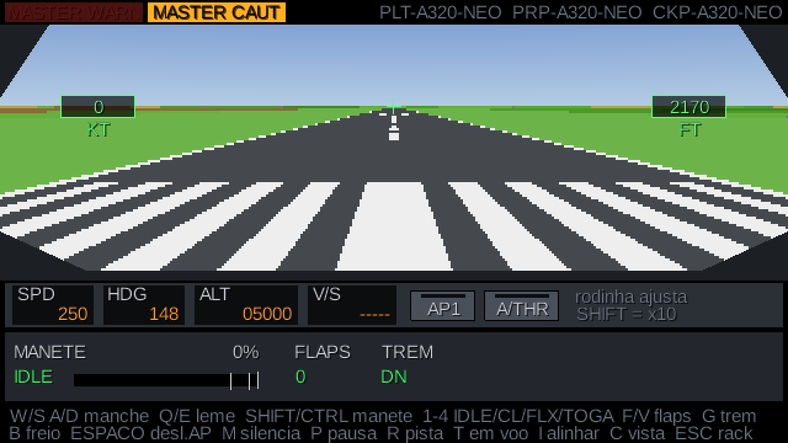
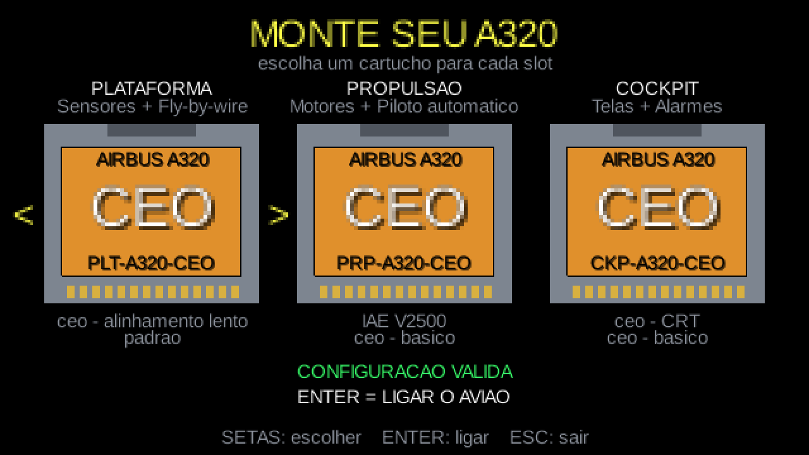
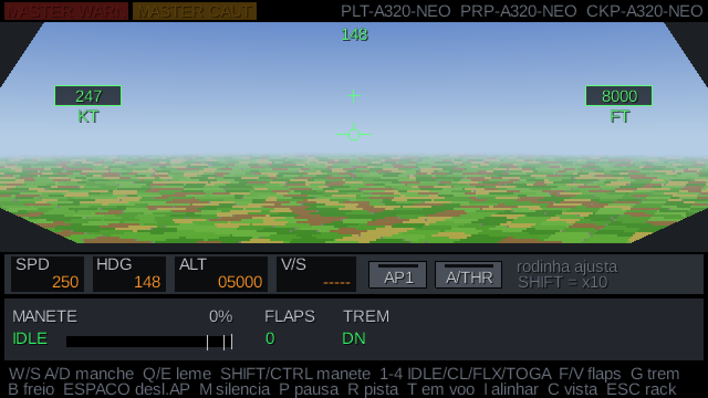
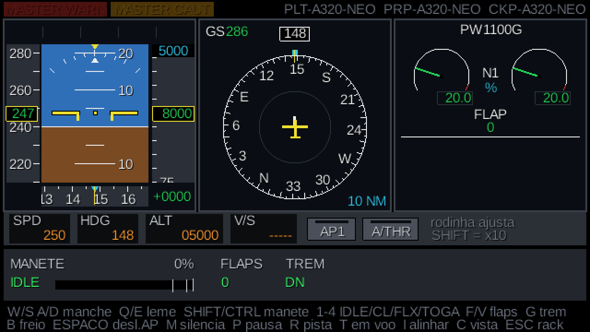
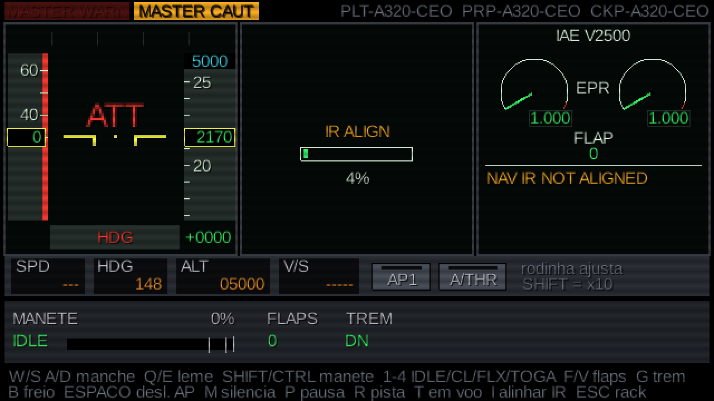
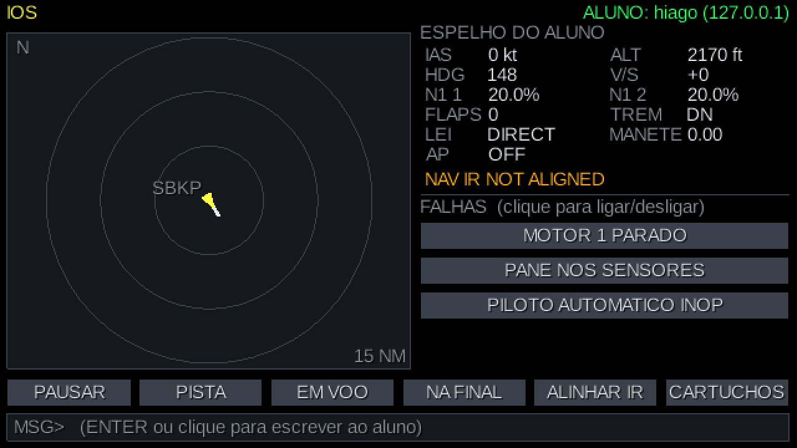

# A320 SIM

Simulador de A320 com estética de console retrô. As "caixas pretas" do avião são carregadas por **cartuchos** (cartões SD), e o instrutor monta o avião escolhendo quais cartuchos encaixar.



| Monte seu A320 | Em voo pela janela |
|---|---|
|  |  |
| **Painel neo (LCD), em voo** | **Painel ceo (CRT), sensores alinhando** |
|  |  |

**Estação do instrutor**, conectada ao aluno pela rede:



## Rack

| Slot | Caixas | ceo | neo |
|---|---|---|---|
| PLATAFORMA | Sensores (ADIRU) + Fly-by-wire (ELAC) | alinhamento lento (90s) | alinhamento rápido (20s) |
| PROPULSAO | Motores (FADEC) + Piloto automático | IAE V2500 (EPR), AP básico HDG/ALT | PW1100G (N1), AP completo + V/S + autothrust |
| COCKPIT | Telas (DMC) + Alarmes (FWC) | CRT, alarmes básicos | LCD, alarmes avançados |

Regra: **PROPULSAO neo exige COCKPIT neo**.

## Módulos do projeto

- `core`: contratos (barramento, `AvionicsModule`, `BaseModule`, cartuchos)
- `flightmodel`: física simplificada (sustentação, arrasto, empuxo, peso, solo)
- `cartridges`: software das caixas
- `host`: o "supercomputador" (rack, cartuchos, loop de simulação, falhas, comandos do instrutor)
- `net`: comunicação TCP entre o PC do instrutor e o do aluno
- `cockpit`: o programa gráfico em LibGDX (título, rack, boot, cockpit, estação do instrutor)
- `sd-dev/`: pastas que fingem ser cartões SD durante o desenvolvimento

## Rodar

```
gradlew :cockpit:run      # o simulador (escolha SOLO, INSTRUTOR ou ALUNO na tela de título)
gradlew :host:run --console=plain   # console de texto do host
gradlew test              # testes (física, voo com piloto automático, falhas, rede)
```

### Treinando em dois PCs (instrutor + aluno)

É o mesmo programa nos dois PCs; na tela de título cada um escolhe o seu papel.

1. **Instrutor:** escolhe **INSTRUTOR**, monta o rack e liga o avião. No topo da estação aparece **"AGUARDANDO ALUNO  IP: ..."**.
2. **Aluno:** escolhe **ALUNO**, digita o IP mostrado no PC do instrutor e aperta ENTER.
3. Quando conecta, o instrutor vê **"ALUNO: nome (ip)"** em verde.

- **Mesmo Wi-Fi/rede:** use o IP local do instrutor (ex.: `192.168.0.15`).
- **Casas diferentes:** os dois instalam a mesma VPN de jogos (**Radmin VPN**, **ZeroTier** ou **Tailscale**) e entram na mesma rede; use o IP que a VPN dá ao instrutor.
- Na primeira vez, o **Firewall do Windows** do instrutor pergunta se libera o Java: permita em redes privadas. A porta usada é a **7320**.

### Estação do instrutor

| Comando | O que faz |
|---|---|
| PAUSAR / CONTINUAR | congela a simulação |
| PISTA | volta o avião à cabeceira |
| EM VOO | 8000 ft, 250 kt, mantendo a proa |
| NA FINAL | alinhado com a pista 15, a 5 NM e 1600 ft |
| ALINHAR IR | alinhamento instantâneo dos sensores |
| CARTUCHOS | desliga o avião e volta ao rack |
| MOTOR 1 PARADO | apaga o motor 1 (alarme ENG 1 FAIL) |
| PANE NOS SENSORES | some velocidade, altitude e atitude; fly-by-wire cai para Lei Direta |
| PILOTO AUTOMATICO INOP | desengaja o AP e impede religar |
| MSG (ENTER) | escreve uma mensagem que aparece na tela do aluno |

O mapa mostra o avião do aluno, o rastro e a pista; o espelho mostra os dados reais e os alertas que o aluno está vendo.

### Comandos do cockpit

| Tecla | Ação |
|---|---|
| W/S, A/D (ou setas) | sidestick: picar/cabrar, rolar |
| Q/E | leme (direção no solo) |
| SHIFT / CTRL | manete +/- |
| 1, 2, 3, 4 | detentes IDLE, CL, FLX, TOGA |
| F / V | flaps baixa / recolhe |
| G | trem de pouso |
| B (segurar) | freio |
| ESPAÇO | desliga o piloto automático |
| M ou clique nas luzes | silencia MASTER WARN / CAUT |
| P | pausa (só no SOLO) |
| R | volta para a pista (só no SOLO) |
| T | reposiciona em voo, 8000 ft e 250 kt (só no SOLO) |
| I | alinhamento instantâneo dos sensores (só no SOLO) |
| C | alterna PAINEL (instrumentos) e JANELA (para-brisa) |
| F12 | screenshot (pasta `screenshots/`) |
| ESC | volta para o rack (SOLO) ou desconecta (ALUNO) |

Mouse no FCU: rodinha sobre SPD/HDG/ALT/V/S ajusta (SHIFT = x10), clique em AP1 e A/THR.

### Decolagem de exemplo

1. Espere os sensores alinharem (ou aperte **I**)
2. **F** (flaps 1), **4** (TOGA)
3. A ~145 kt, segure **S** até o nariz subir ~10°
4. Já no ar: **G** (recolhe o trem), **V** (flaps 0), **2** (CL)
5. Ajuste ALT e HDG no FCU e clique **AP1** (no neo, também **A/THR**)

## Fases

0. Fundação: rack, cartuchos, barramento e console ✅
1. Modelo de voo simplificado ✅
2. Cockpit 2D (PFD, ND, ECAM), teclado e mouse, sons ✅ e vista pela janela estilo Mode 7 ✅
3. Cartuchos reais: leitores SD (ou `subst`/pendrive), `.jar` por cartucho
4. Rede instrutor ↔ aluno + estação do instrutor (falhas, pausa, reposicionamento, mensagens) ✅
5. Estação do instrutor completa: clima, snapshots, falhas programadas, mais falhas
6. Polimento: mais cenário (nuvens, noite, aeroportos), fonte pixel, debriefing
