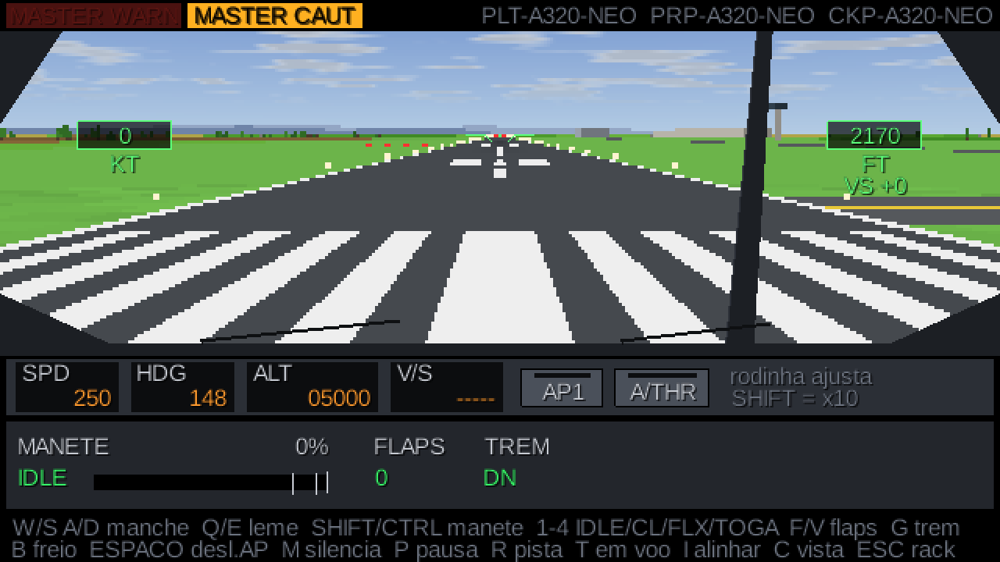
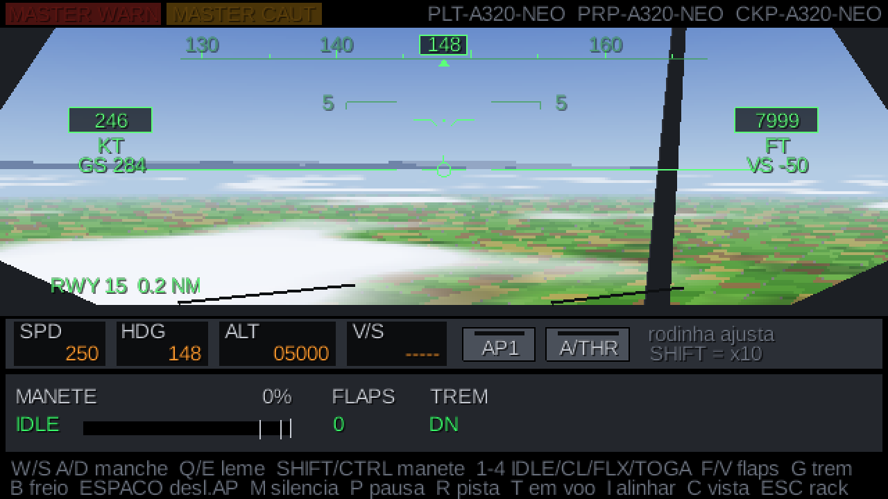
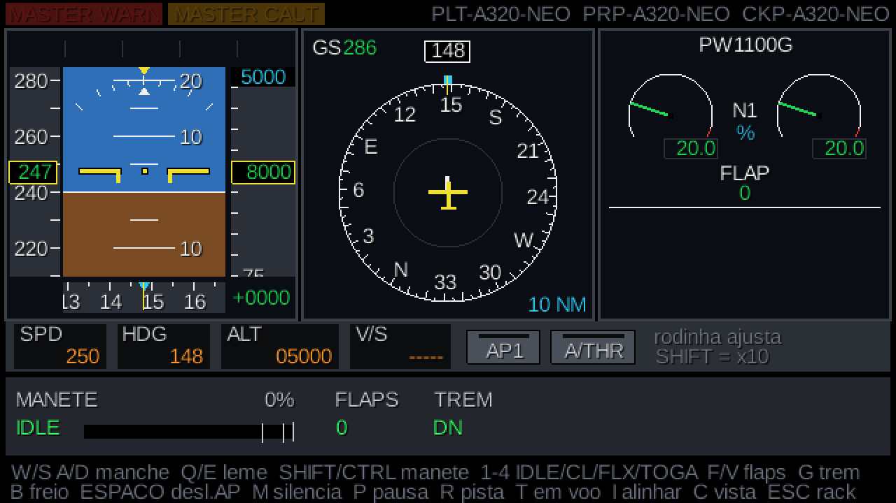
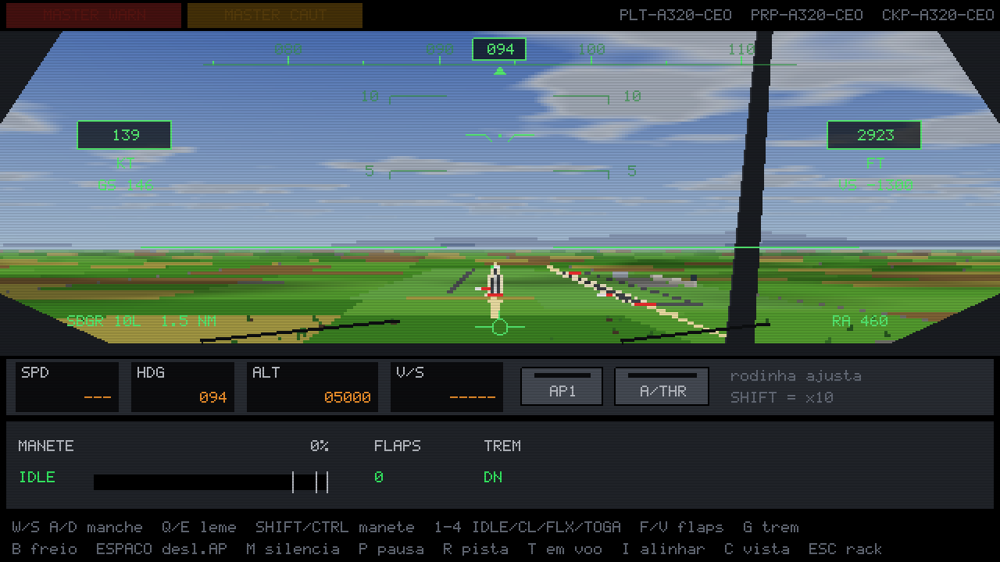
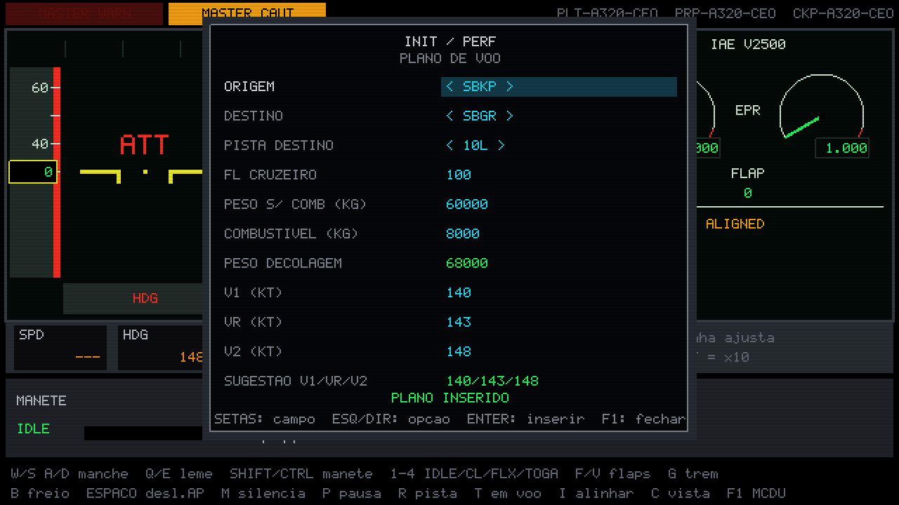
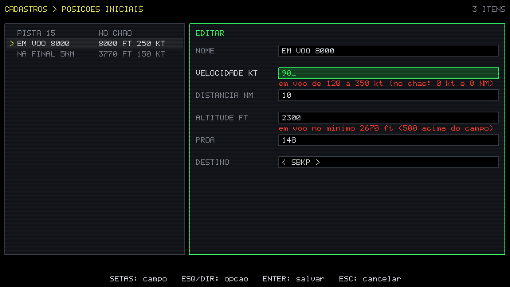
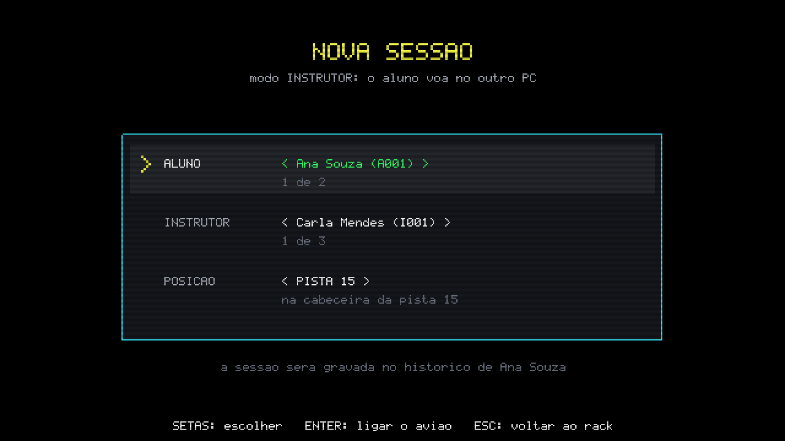
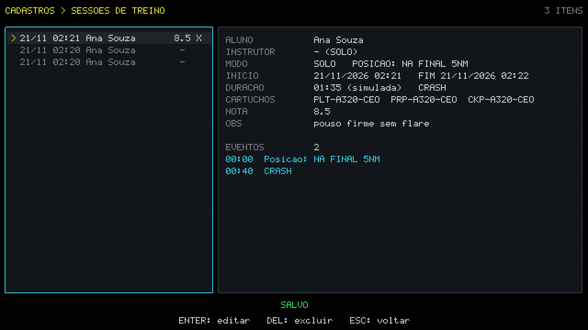

# SICA

**Simulador Integrado de Configuração Aeronáutica**

Simulador de jato bimotor com estética de console retrô. As "caixas pretas" do avião são carregadas por **cartuchos** (cartões SD), e o instrutor monta o avião escolhendo quais cartuchos encaixar.



| Monte sua aeronave | Em voo pela janela |
|---|---|
|  |  |
| **Painel neo (LCD), em voo** | **Painel ceo (CRT), sensores alinhando** |
|  |  |

**Estação do instrutor**, conectada ao aluno pela rede:


## Rack

| Slot | Caixas | ceo | neo |
|---|---|---|---|
| PLATAFORMA | Sensores (ADIRU) + Fly-by-wire (ELAC) | alinhamento lento (90s) | alinhamento rápido (20s) |
| PROPULSAO | Motores (FADEC) + Piloto automático | IAE V2500 (EPR), AP básico HDG/ALT | PW1100G (N1), AP completo + V/S + autothrust |
| COCKPIT | Telas (DMC) + Alarmes (FWC) | CRT, alarmes básicos | LCD, alarmes avançados |

Regra: **PROPULSAO neo exige COCKPIT neo**.

## Cartões SD

Cada cartão leva quatro arquivos na raiz:

| Arquivo | Para que serve |
|---|---|
| `cartridge.json` | o manifesto (grupo, versão, caixas, requisitos) |
| `caixas.jar` | o software das duas caixas daquele cartão |
| `checksum.sha256` | o SHA-256 de `cartridge.json` e `caixas.jar` (**integridade**) |
| `assinatura.sig` | a assinatura Ed25519 do checksum, feita com a chave da fábrica (**autenticidade**) |

O simulador varre os leitores a cada ~0,7 s; o **grupo vem do manifesto**, então não importa em qual leitor do hub o cartão entra.

**Assinatura dos cartões.** Antes de carregar qualquer classe do `caixas.jar`, o data loader confere a assinatura com a chave pública que vai dentro do programa e depois o hash de cada arquivo. Se algo não bate, o cartão é **RECUSADO** e nenhum código dele roda:

| Mensagem | Quando acontece |
|---|---|
| `RECUSADO: SEM ASSINATURA` | faltam `checksum.sha256` ou `assinatura.sig` |
| `RECUSADO: ASSINATURA INVALIDA` | assinado com outra chave, ou checksum editado |
| `RECUSADO: ARQUIVO CORROMPIDO` | o `.jar` ou o manifesto mudou depois de assinado |
| `RECUSADO: ARQUIVO FALTANDO` | um arquivo listado no checksum sumiu |
| `RECUSADO: SEM CHAVE PUBLICA` | o programa foi compilado sem a chave da fábrica |
| `RECUSADO: CARTAO BLOQUEADO` | o cartão está `BLOQUEADO` ou `PERDIDO` no cadastro de cartões (conferido depois da assinatura) |

Para conferir um cartão no terminal (Git Bash ou Linux): `sha256sum -c checksum.sha256` dentro da unidade.

**Chaves (uma vez só, para a equipe toda).** Quem grava os cartões roda:

```
gradlew :cartridges:gerarChaves
```

Isso cria `chaves/fabrica-privada.key` (**nunca vai para o Git**, já está no `.gitignore`; guarde uma cópia e passe para a equipe por fora do GitHub) e `host/src/main/resources/chave-publica-cartuchos.txt` (essa vai para o Git). Gerar chaves novas invalida todos os cartões já gravados. Sem a chave privada, `sdImages` gera imagens sem assinatura e `gravarSd` se recusa a gravar. Os testes usam uma chave própria e não dependem da chave da equipe.

**Gravar os 6 cartões** (uma vez, ou de novo quando o software das caixas mudar). Com o cartão no leitor, veja a letra dele no Explorer e rode:

```
gradlew :cartridges:gravarSd -Pcartao=PLT-A320-CEO -Pdrive=G
```

Repita para `PLT-A320-NEO`, `PRP-A320-CEO`, `PRP-A320-NEO`, `CKP-A320-CEO` e `CKP-A320-NEO`, e etiquete cada cartão. A tarefa só copia os quatro arquivos (não formata); ela recusa a unidade do sistema, a do projeto e qualquer unidade com mais de 64 GB. `gradlew :cartridges:sdImages` só gera as imagens em `cartridges/build/sd/`.

**Usando:**

- Na tela **MONTE SUA AERONAVE**, encaixar um cartão no leitor coloca ele direto no slot do grupo dele; tirar o cartão esvazia o slot. As setas continuam funcionando quando há mais de um cartão do mesmo grupo plugado.
- **Com o avião ligado**, tirar um cartão desliga as caixas dele na hora (ex.: sem o COCKPIT as telas apagam e os alarmes somem) e aparece **CARTUCHO REMOVIDO** no cockpit e no log do instrutor. Encaixar de volta (em qualquer leitor) faz o *data loading* e as caixas religam com self-test; os sensores precisam alinhar de novo. Cartão incompatível (ex.: COCKPIT ceo com PROPULSAO neo) é recusado.
- O `.jar` é copiado para `cache/` antes de carregar, então o Windows não trava o arquivo no cartão.

**Fonte dos cartuchos** (`-Dsim.cartridges=...`):

| Valor | Usa |
|---|---|
| `auto` (padrão) | cartões SD; se nenhum estiver plugado, as pastas `sd-dev/` |
| `sd` | só cartões SD |
| `dev` | só `sd-dev/` |

Outras opções: `-Dsim.sd.drives=G,H,I` limita a busca a essas letras; `-Dsim.sd.roots=pastaA;pastaB` usa pastas fingindo ser leitores (copie uma imagem de `cartridges/build/sd/` para dentro para "encaixar", apague para "arrancar").

## Módulos do projeto

- `core`: contratos (barramento, `AvionicsModule`, `BaseModule`, cartuchos)
- `flightmodel`: física simplificada (sustentação, arrasto, empuxo, peso, solo)
- `cartridges`: software das caixas
- `host`: o "supercomputador" (rack, cartuchos, loop de simulação, falhas, comandos do instrutor)
- `net`: comunicação TCP entre o PC do instrutor e o do aluno
- `dados`: cadastros e histórico de treino num banco H2 embutido (JDBC puro). O `host` não depende dele: só define as interfaces (`CardPolicy`, `SessionStore`) que o `dados` implementa
- `cockpit`: o programa gráfico em LibGDX (título, rack, boot, cockpit, estação do instrutor)
- `sd-dev/`: pastas que fingem ser cartões SD durante o desenvolvimento (e a fonte das imagens gravadas nos cartões). Elas não têm `.jar`, então não passam pela assinatura: o software vem do próprio programa

## Rodar

```
gradlew :cockpit:run      # o simulador (escolha SOLO, INSTRUTOR ou ALUNO na tela de título)
gradlew :host:run --console=plain   # console de texto do host
gradlew test              # testes (física, voo, falhas, rede, cadastros, formulário)
```

### Treinando em dois PCs (instrutor + aluno)

É o mesmo programa nos dois PCs; na tela de título cada um escolhe o seu papel.

1. **Instrutor:** escolhe **INSTRUTOR**, monta o rack e liga o avião. No topo da estação aparece **"AGUARDANDO ALUNO  IP: ..."**.
2. **Aluno:** escolhe **ALUNO**, digita o IP mostrado no PC do instrutor e aperta ENTER.
3. Quando conecta, o instrutor vê **"ALUNO: nome (ip)"** em verde.

- **Mesmo Wi-Fi/rede:** use o IP local do instrutor (ex.: `192.168.0.15`).
- **Casas diferentes:** os dois instalam a mesma VPN de jogos (**Radmin VPN**, **ZeroTier** ou **Tailscale**) e entram na mesma rede; use o IP que a VPN dá ao instrutor.
- Na primeira vez, o **Firewall do Windows** do instrutor pergunta se libera o Java: permita em redes privadas. A porta usada é a **7320**.

### Estação do instrutor

| Comando | O que faz |
|---|---|
| PAUSAR / CONTINUAR | congela a simulação |
| PISTA | volta o avião à cabeceira |
| POS: &lt;nome&gt; | escolhe uma das posições iniciais cadastradas (cada clique passa para a próxima) |
| IR P/ POSICAO | põe o avião na posição escolhida (no chão: cabeceira da pista dela; em voo: no prolongamento da pista, com os sensores alinhados) |
| ALINHAR IR | alinhamento instantâneo dos sensores |
| CARTUCHOS | desliga o avião e volta ao rack |
| MOTOR 1 PARADO | apaga o motor 1 (alarme ENG 1 FAIL) |
| PANE NOS SENSORES | some velocidade, altitude e atitude; fly-by-wire cai para Lei Direta |
| PILOTO AUTOMATICO INOP | desengaja o AP e impede religar |
| VENTO | alterna CALMO, TRAVES 15 KT (pela direita da pista de destino, turbulência leve) e FORTE 30 KT (40° da pista, turbulência forte); o vento aparece no ND |
| AVES | solta um bando de aves cruzando o caminho do avião, ~1,5 NM à frente |
| AVES AUTO | bandos ao acaso perto dos aeroportos, abaixo de 3000 ft (desligado no começo de cada sessão) |
| MSG (ENTER) | escreve uma mensagem que aparece na tela do aluno |

O mapa mostra o avião do aluno, o rastro e a pista; o espelho mostra os dados reais e os alertas que o aluno está vendo.

### Comandos do cockpit

| Tecla | Ação |
|---|---|
| W/S, A/D (ou setas) | sidestick: picar/cabrar, rolar |
| Q/E | leme (direção no solo) |
| SHIFT / CTRL | manete +/- |
| 1, 2, 3, 4 | detentes IDLE, CL, FLX, TOGA |
| F / V | flaps baixa / recolhe |
| G | trem de pouso |
| B (segurar) | freio |
| ESPAÇO | desliga o piloto automático |
| M ou clique nas luzes | silencia MASTER WARN / CAUT |
| P | pausa (só no SOLO) |
| R | volta para a pista (só no SOLO) |
| T | reposiciona em voo, 8000 ft e 250 kt (só no SOLO) |
| I | alinhamento instantâneo dos sensores (só no SOLO) |
| C | alterna PAINEL (instrumentos) e JANELA (para-brisa) |
| F12 | screenshot (pasta `screenshots/`) |
| F1 | abre e fecha o MCDU (plano de voo) |
| ESC | volta para o rack (SOLO) ou desconecta (ALUNO); com o MCDU aberto, só fecha o MCDU |

### Controle de videogame (modo simplificado)

Plugue um controle (Xbox, PlayStation ou genérico), antes ou durante o voo, e ele assume sozinho. Aparece **CONTROLE CONECTADO** e o voo fica só no acelerar e dar direção:

| Controle | Ação |
|---|---|
| Analógico esquerdo | direção: para os lados inclina as asas (e vira a roda do nariz no chão); puxar sobe o nariz, empurrar desce |
| RT | acelera |
| LT | reduz; com a manete toda atrás, freia |
| A | desliga o piloto automático |
| Y | alterna PAINEL / JANELA |
| Start | pausa (SOLO) |
| Back | volta para o rack (SOLO) ou desconecta (ALUNO) |

Nos menus (abertura, título, rack, conexão) o controle também navega: direcional ou analógico para mover, **A** confirma, **B** volta.

Flaps e trem ficam **automáticos**: flaps 1 para decolar e recolhendo conforme ganha velocidade; na aproximação, flaps e trem baixam conforme o avião desacelera e desce. Desconectou o controle, o teclado volta no modo completo com a manete, os flaps e o trem onde estavam. Pausa, reposicionar e ESC continuam no teclado.

Mouse no FCU: rodinha sobre SPD/HDG/ALT/V/S ajusta (SHIFT = x10), clique em AP1 e A/THR.

### Decolagem de exemplo

1. Espere os sensores alinharem (ou aperte **I**)
2. **F** (flaps 1), **4** (TOGA)
3. A ~145 kt, segure **S** até o nariz subir ~10°
4. Já no ar: **G** (recolhe o trem), **V** (flaps 0), **2** (CL)
5. Ajuste ALT e HDG no FCU e clique **AP1** (no neo, também **A/THR**)

## Aeroportos



| Aeroporto | Elevação | Pistas (comprimento) |
|---|---|---|
| **SBKP** Viracopos | 2170 ft | 15/33 (3240 m) |
| **SBGR** Guarulhos | 2459 ft | 10L/28R (3700 m), 10R/28L (3000 m) |
| **SBSP** Congonhas | 2631 ft | 17R/35L (1940 m), 17L/35R (1435 m) |

Todas as pistas podem ser usadas nas posições iniciais. O seed traz, além das de Viracopos, **FINAL GRU 10L**, **FINAL CGH 17R** (5 NM, 1600 ft acima do aeroporto) e **PISTA GRU 10L**, **PISTA CGH 17R** (na cabeceira). Guarulhos usa a numeração atual: desde 2022 as pistas são 10L/28R e 10R/28L (eram 09L/27R e 09R/27L), por causa da mudança do campo magnético.

**Como o mundo é montado** (`flightmodel/.../world`):

- As pistas saem das coordenadas das duas cabeceiras (latitude/longitude), convertidas para milhas náuticas a partir da cabeceira 15 de Viracopos (origem do mundo), com a aproximação de Terra plana (erro de décimos de milha nessas distâncias).
- O mapa é alinhado ao **norte magnético**, que é o que o piloto lê nos instrumentos: ele é girado ~20° para a pista 15 continuar com proa 148. Com isso as outras proas também ficam perto das magnéticas publicadas (10L ≈ 094, 17R ≈ 168).
- O terreno é plano na elevação de cada aeroporto até 6,5 NM dele e varia suavemente entre eles. O altímetro, a altitude de rádio e o toque no chão usam esse terreno.
- Cabeceiras deslocadas não são representadas. Taxiways, pátios e terminais são ilustrativos.

**Fontes dos dados** (públicas, não oficiais; coordenadas e comprimentos conferidos entre elas, novembro de 2026):

- Viracopos: [sprinkle.com/airport/SBKP](https://sprinkle.com/airport/SBKP), [pilotnav.com/airport/SBKP](https://pilotnav.com/airport/SBKP), [airport-data.com SBKP](https://airport-data.com/world-airports/SBKP-VCP/)
- Guarulhos: [skyvector.com SBGR](https://skyvector.com/airport/SBGR/Guarulhos-Gov-Andre-F-Montoro-Airport), [pilotnav.com/airport/SBGR](https://www.pilotnav.com/airport/SBGR), [sprinkle.com/airport/SBGR](https://sprinkle.com/airport/SBGR), [airportguide.com GRU](https://airportguide.com/airport/info/GRU); renumeração das pistas: [Gazeta SP](https://www.gazetasp.com.br/estado/aeroporto-de-guarulhos-opera-com-novos-numeros-de-cabeceiras-de-pista/)
- Congonhas: [skyvector.com SBSP](https://skyvector.com/airport/SBSP/Congonhas-Airport), [pilotnav.com/airport/SBSP](https://pilotnav.com/airport/SBSP), [sprinkle.com/airport/SBSP](https://sprinkle.com/airport/SBSP), [skybrary.aero SBSP](https://skybrary.aero/airports/sbsp)

Para dados oficiais, a referência é o AIP Brasil no [AISWEB do DECEA](https://aisweb.decea.mil.br/). Os números do simulador servem para treino, não para navegação.

## Vento, obstáculos e aves

- **Vento e turbulência** (botão VENTO na IOS): o avião deriva com o vento, o velocímetro mede o ar e a velocidade sobre o chão (GS) soma ou desconta o vento. A turbulência sacode em subida/descida, inclinação (que volta sozinha: o fly-by-wire segura a atitude) e velocidade. As rajadas são sorteadas com semente fixa, então o mesmo voo se repete igual nos testes.
- **Prédios e árvores**: as cidades de Campinas, São Paulo (Congonhas fica dentro dela) e Guarulhos, e as árvores das plantações, saem de um gerador compartilhado pela vista e pelo modelo de voo. Bater num prédio ou árvore é CRASH, com o evento **COLISAO COM PREDIO** ou **COLISAO COM ARVORE** no histórico da sessão. A altura dos prédios segue as zonas de proteção de aeródromo: ao lado da pista há uma faixa livre (240 a 440 m do eixo, mais larga do lado do terminal), depois casas baixas que sobem 1 m a cada 7 m de afastamento (superfície de transição); antes de cada cabeceira, uma rampa de 2°. Uma aproximação na rampa de 3° nunca bate.
- **Aves**: o bando voa em V, migrando a 30 kt. Atravessar o bando para o motor do lado atingido (ENG FAIL) e, pelo meio, os dois; o evento **COLISAO COM AVES (MOTOR 1)** vai para o histórico. O bando passa pelo barramento, então o aluno também vê pela janela.

Atalhos para testar sem teclado: `-Dsim.vento=1` (ou `2`) aplica uma predefinição de vento depois do boot; `-Dsim.aves=1` solta um bando à frente e `-Dsim.aves=auto` liga as aves automáticas.

## Plano de voo (MCDU)



Na cabine, **F1** abre o MCDU (página INIT/PERF). O aluno preenche, antes de decolar:

| Campo | Regra |
|---|---|
| Origem e destino | SBKP, SBGR ou SBSP (a origem começa no aeroporto mais perto, o destino no da sessão) |
| Pista de destino | uma pista que exista no destino |
| FL de cruzeiro | de 050 a 410, de 10 em 10 |
| Peso sem combustível | de 42.000 a 62.500 kg |
| Combustível | de 1.000 a 18.700 kg; o peso de decolagem (os dois somados) não pode passar de 78.000 kg |
| V1, VR, V2 | de 100 a 180 kt, com V1 ≤ VR ≤ V2; o MCDU mostra as velocidades sugeridas para o peso |

Ao lado do MCDU fica um **bloco de notas** com três planos de exemplo prontos para copiar (voo curto para Guarulhos, ponte para Congonhas e um circuito em Viracopos) e dicas de preenchimento. Setas trocam de campo e de opção, **ENTER** insere, **F1** ou **ESC** fecha. Enquanto o MCDU está aberto, o teclado não pilota (o avião segue com os últimos comandos). Campos obrigatórios vazios aparecem como caixinhas âmbar, como no avião de verdade; erros em vermelho.

Plano inserido:

- o peso de decolagem vira o peso do avião no modelo de voo (sem plano, 66 t); mais pesado, ele precisa de mais pista. O combustível é só um número do plano, não é consumido;
- as marcas **1**, **R** e **2** aparecem na fita de velocidade do PFD;
- a pista de destino do plano vira o destino da sessão (distância no HUD);
- a IOS mostra o resumo do plano no topo, ou **SEM PLANO** piscando;
- o plano vai para o log e fica gravado na sessão (histórico de treino).

Decolar sem plano não é bloqueado: fica registrado como **SEM PLANO DE VOO** no log da sessão. No modo ALUNO, o plano vai do PC do aluno para o instrutor junto com os comandos do manche.

Atalhos para testar: `-Dsim.mcdu` abre o MCDU ao entrar na cabine; `-Dsim.plano=SBKP,SBGR,10L,100,60000,8000,140,143,148` insere esse plano (no modo INSTRUTOR, faz de conta que o aluno inseriu).

## Tela e ampliação

A imagem é desenhada em 640x360 e ampliada em múltiplos inteiros. As linhas de varredura de CRT aparecem nos menus e nas telas do painel ceo (que são CRT), não na vista pela janela; `-Dsim.scanlines=off` desliga o efeito. `-Dsim.janela=1920x1009` abre a janela num tamanho dado (para conferir a ampliação).

## Cadastros e histórico de treino



| Nova sessão | Histórico com os eventos do voo |
|---|---|
|  |  |

O simulador guarda cadastros e o histórico das aulas num banco **H2 em arquivo** (não precisa instalar nada). Em desenvolvimento ele fica em `dados/sica.mv.db` (fora do Git); `-Dsim.db=pasta/arquivo` troca o lugar. O esquema é criado e atualizado sozinho pelos scripts `dados/src/main/resources/db/V1__schema.sql`, `V2__seed.sql`... (cada um roda uma vez; a tabela `versao_esquema` guarda quais já rodaram). O seed traz 2 alunos, 2 instrutores, os 6 cartões (SD-01 a SD-06) e 3 posições.

Na tela de título, **4 CADASTROS** abre:

| Cadastro | Regras |
|---|---|
| **Pessoas** (alunos e instrutores) | nome de 3 a 40 caracteres; matrícula obrigatória e única; e-mail válido se preenchido. Quem já tem sessões não é excluído, só desativado |
| **Cartões** SD físicos | part number obrigatório; etiqueta opcional, até 10 caracteres e única. Cartão desconhecido lido com sucesso é cadastrado sozinho (sem etiqueta, para preencher); se já existe um cadastro manual com o mesmo part number e sem identificador, ele é adotado. Cada inserção no leitor conta uma leitura (data, contador e hash do `caixas.jar`). O identificador é o número de série do volume FAT32 |
| **Posições iniciais** | nome único de 3 a 16 caracteres; altitude 0 a 41000 ft; proa 0 a 359; distância 0 a 100 NM; destino (SBKP, SBGR ou SBSP) e uma pista que exista nele. **No chão** = velocidade 0 e distância 0 (a altitude vira a do aeroporto de destino e fica bloqueada no formulário); **em voo** = 120 a 350 kt e pelo menos 500 ft acima do aeroporto de destino. Posição usada em sessões não pode ser excluída |
| **Sessões de treino** | gravadas pelo simulador: aqui só se vê (com os eventos), avalia (nota de 0 a 10 com uma casa, ou vazia) e exclui |

Teclas: **N** novo, **ENTER** editar, **DEL** excluir (pede confirmação), **ESC** voltar. No formulário: **setas cima/baixo** (ou TAB) trocam de campo, **esquerda/direita** mudam as opções, **ENTER** salva, **ESC** cancela. Os erros aparecem em vermelho embaixo do campo.

**Sessão de treino.** Depois de montar o rack vem a tela **NOVA SESSAO**: aluno, instrutor (só no modo INSTRUTOR) e posição inicial. Depois do boot o avião vai para a posição escolhida e a sessão começa a ser gravada: os comandos do instrutor e os eventos automáticos (**DECOLAGEM**, **POUSO V/S -620 FT/MIN**, **CRASH**, cartucho removido/carregado) vão para o banco a cada segundo, então um travamento perde no máximo o último segundo. A sessão fecha ao voltar para o rack, para o título ou ao fechar o programa, com a duração simulada, se houve crash e os cartuchos usados.

**Sem banco.** Se o arquivo não abrir (ex.: outro simulador no mesmo PC já está com ele), aparece **SEM BANCO** no título e na IOS e o erro vai para o console: o simulador funciona normalmente, só não grava e não confere o cadastro de cartões. O modo ALUNO nunca abre o banco (quem grava é o PC do instrutor).

Atalhos para testar sem teclado: `-Dsim.posicao="EM VOO 8000"` escolhe a posição com `-Dsim.autostart`; `-Dsim.crud=posicoes,1,editar,velocidade=90,salvar` abre um cadastro, escolhe o item, troca um campo e tenta salvar.

## Fases

0. Fundação: rack, cartuchos, barramento e console ✅
1. Modelo de voo simplificado ✅
2. Cockpit 2D (PFD, ND, ECAM), teclado e mouse, sons ✅ e vista pela janela estilo Mode 7 ✅
3. Cartuchos reais: leitores SD, `.jar` por cartão, encaixar/arrancar com o avião ligado ✅
4. Rede instrutor ↔ aluno + estação do instrutor (falhas, pausa, reposicionamento, mensagens) ✅
5. Estação do instrutor completa: clima, snapshots, falhas programadas, mais falhas
6. Polimento: mais cenário (nuvens, noite, aeroportos), fonte pixel, debriefing
